# 移动机器人机电系统设计与 ROS 自主导航

**Mobile Robot Navigation & Arduino Control** · 本科毕业设计（2025）· 公开归档版 `v1.0.1`

[](https://github.com/sws341/ros-mobile-robot-navigation/actions/workflows/static-validation.yml)
[](LICENSE)
[](firmware/THIRD_PARTY_LICENSE_BSD.txt)

> 这是一份经过清理和审查的历史工程归档：已完成源码归属梳理、静态检查、图片与内部链接检查；**尚未在本次发布环境完成 ROS/catkin 构建、Arduino UNO 编译或新的实机复测**。它适合代码阅读、求职展示和后续复现，不应被视为开箱即用的安全控制产品。

`ROS 1` · `GMapping` · `AMCL` · `Move Base` · `URDF/Xacro` · `Arduino UNO R3` · `Sensor Shield V5` · `L298N` · `Encoder/PID/PWM`

## 项目实物与实验平台

| 履带式机械结构样机 | 独立四轮导航实验平台 |
|:--:|:--:|
| 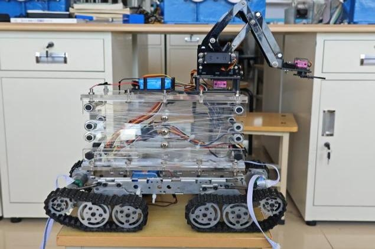 | 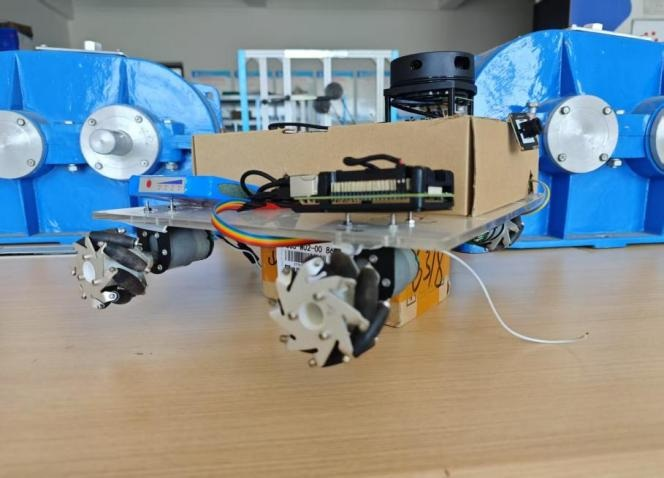 |

**两种平台必须区分：** 履带底盘、三级剪叉升降机构和四自由度机械臂属于机械设计样机；ROS 实景建图、定位和四目标点导航演示使用的是右图所示的独立四轮实验平台。本仓库不宣称履带样机完成了同等导航实测。

## 项目概述

项目面向高危环境远程作业场景，覆盖机械结构设计、机电硬件集成、ROS 1 导航栈配置和 Arduino 下位机运动控制。正式论文题目为《基于树莓派与激光 LiDAR 的高危环境自主导航小车的系统设计》，获校级优秀毕业论文（设计）。

个人工作主要包括：

1. 履带底盘、剪叉升降机构、机械臂及夹爪的结构方案与样机集成。
2. RPLIDAR A1、编码器、Arduino UNO R3、Sensor Shield V5 和 L298N 等硬件选型与接线联调。
3. GMapping、Map Server、AMCL、Move Base、RViz 的 ROS Launch/YAML/URDF 工程配置。
4. 基于 ROSArduinoBridge 的四路编码器、PID/PWM、电机驱动和串口协议适配。
5. 仿真与独立四轮平台上的历史建图、定位、路径规划及目标点演示。

GMapping、AMCL、Move Base、ROSArduinoBridge、雷达和相机驱动均为第三方开源组件；本项目的贡献定位是**机械设计、系统集成、配置与调试**，不是从零开发 SLAM 或导航核心算法。详见 [个人贡献边界](docs/PROJECT_ORIGINALITY.md) 和 [第三方来源](docs/THIRD_PARTY.md)。

## 系统架构

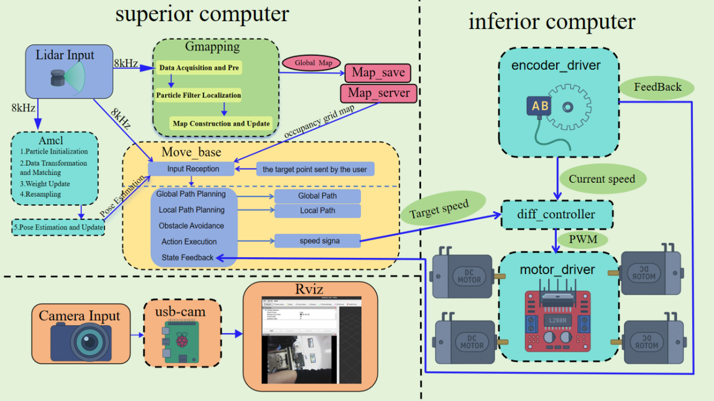

```mermaid
flowchart LR
  lidar[RPLIDAR A1 /scan] --> gmapping[GMapping]
  gmapping --> map[Map Server /map]
  lidar --> amcl[AMCL]
  map --> amcl
  amcl --> movebase[Move Base]
  movebase --> cmd[/cmd_vel]
  cmd --> bridge[ros_arduino_python]
  bridge --> uno[Arduino UNO R3 + Sensor Shield V5]
  uno --> driver[L298N + PWM]
  driver --> motors[四轮电机]
  motors --> encoders[四路霍尔编码器]
  encoders --> uno
  bridge --> odom[/odom]
  odom --> amcl
```

| 硬件总体框图 | UNO R3 与 Shield V5 接线示意 |
|:--:|:--:|
| 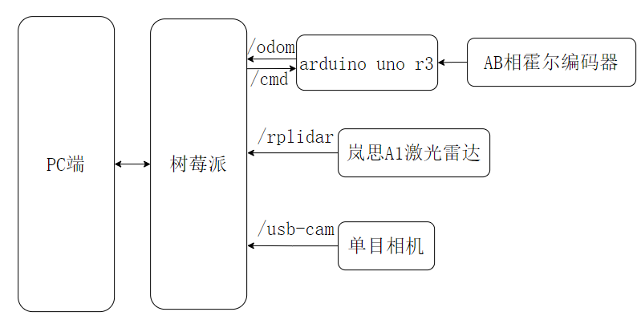 | 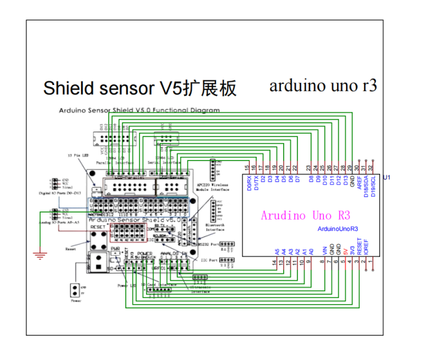 |

> 接线图是论文归档的历史设计，不是经过本次发布重新验证的安全接线规范。上电前必须核对供电、电平、共地、引脚和急停措施。

## 导航与控制实验记录

| 实景建图 | AMCL 实景定位 |
|:--:|:--:|
| 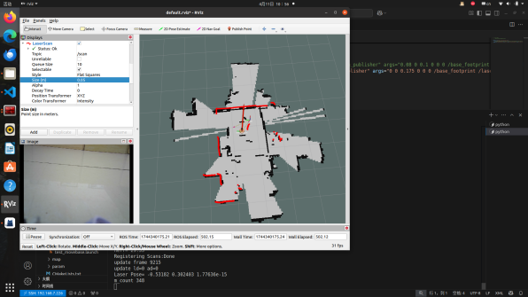 | 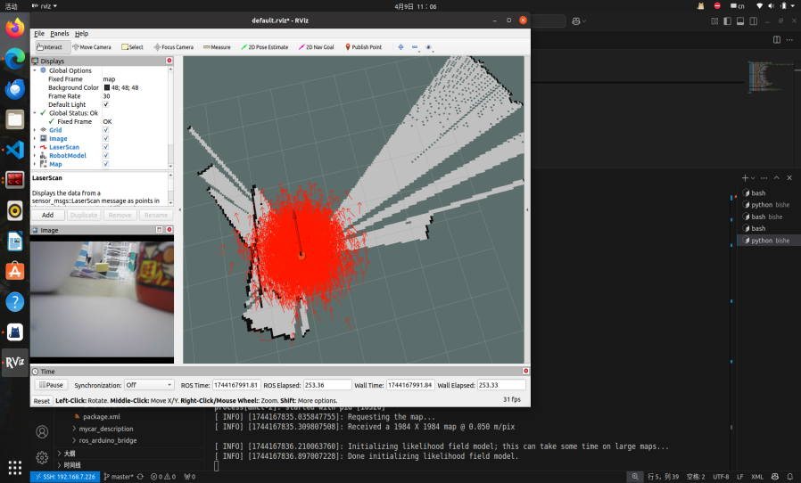 |

| 仿真全局路径 | 四轮平台装配状态 |
|:--:|:--:|
| 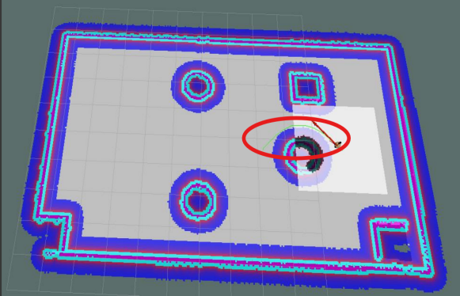 | 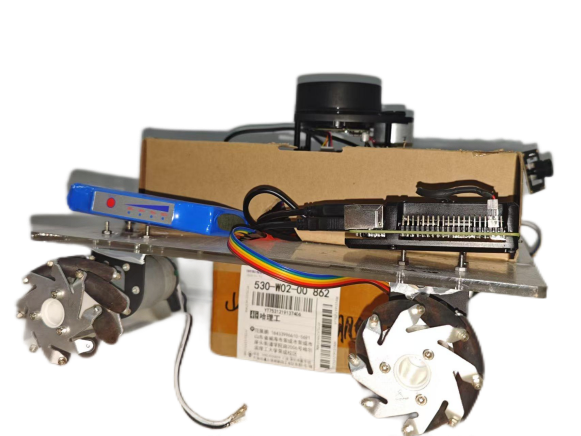 |

| 电机与编码器接线 | 历史 PID 转速曲线 |
|:--:|:--:|
| 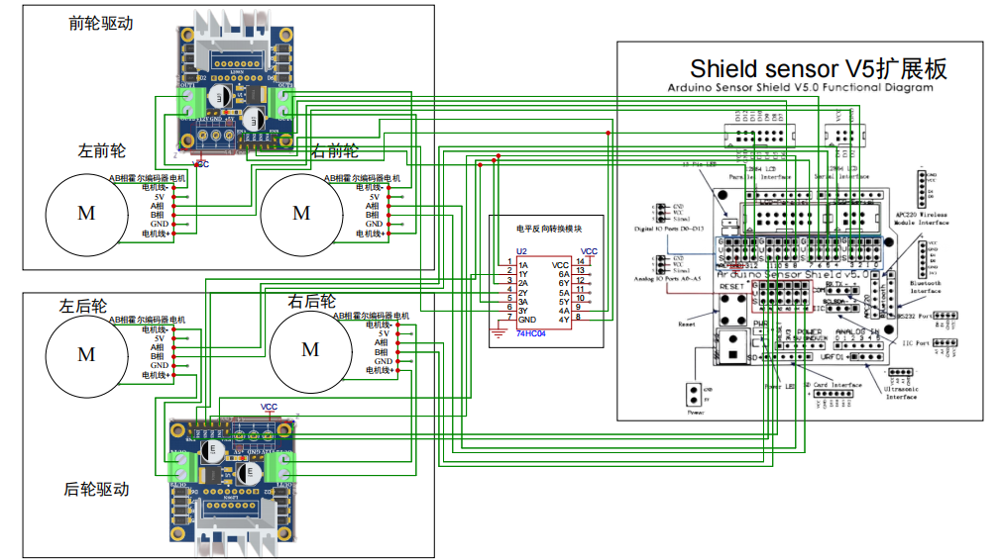 | 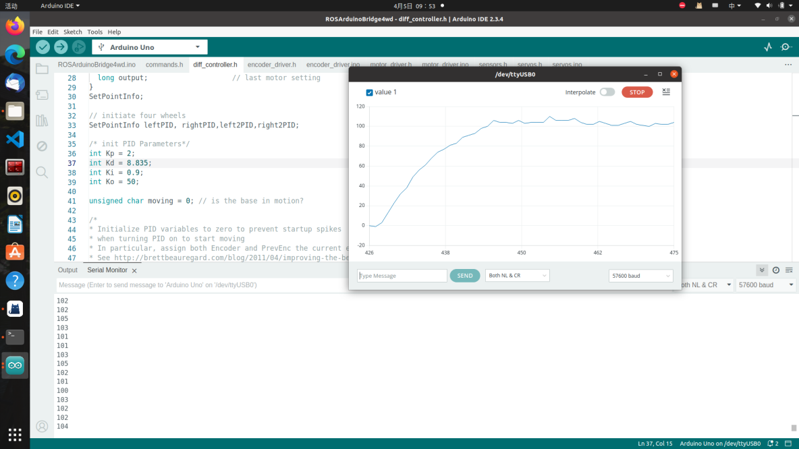 |

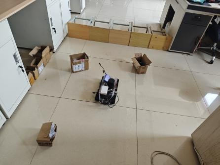

以上均为本科论文中的历史过程记录。仓库没有足够原始数据计算可信的成功率、定位误差或 PID 超调量，因此不提供虚构的性能指标。全部图片索引见 [图源清单](docs/FIGURE_SOURCES.md)。

## 代码入口

| 模块 | 入口 | 说明 |
|---|---|---|
| 上位机组合启动 | [`car_start/launch/start.launch`](ros_ws/src/car_start/launch/start.launch) | 串口、相机、雷达和机器人描述；依赖外部 ROS 包 |
| 串口与底盘参数 | [`arduino_params.yaml`](ros_ws/src/car_start/config/arduino_params.yaml) | 端口、波特率、轮径、轮距、编码器分辨率和 PID 参数 |
| SLAM/定位/导航 | [`daohang/launch/`](ros_ws/src/daohang/launch) | GMapping、AMCL、Map Server、Move Base 启动配置 |
| 导航参数与地图 | [`daohang/param/`](ros_ws/src/daohang/param) · [`daohang/map/`](ros_ws/src/daohang/map) | 代价地图、局部规划器和历史地图 |
| 机器人模型 | [`mycar_description/urdf/`](ros_ws/src/mycar_description/urdf) | 四轮实验平台的 URDF/Xacro |
| Arduino 固件 | [`ROSArduinoBridge4wd.ino`](firmware/ROSArduinoBridge4wd/ROSArduinoBridge4wd.ino) | 已确认的独立 `ros_arduino_bridge` 固件副本 |
| PID 控制 | [`diff_controller.h`](firmware/ROSArduinoBridge4wd/diff_controller.h) | v1.0.0 修复小数增益被整型截断的问题；仍需重新整定 |
| 电机/编码器 | [`motor_driver.h`](firmware/ROSArduinoBridge4wd/motor_driver.h) · [`encoder_driver.ino`](firmware/ROSArduinoBridge4wd/encoder_driver.ino) | UNO R3 引脚、L298N PWM 和四路编码器 |

## 仓库结构

```text
.
├── .github/workflows/              # GitHub Actions 静态检查
├── assets/figures/                 # 本科论文中的项目实物、架构、接线和实验图
├── firmware/
│   ├── ROSArduinoBridge4wd/         # 修改版第三方 BSD 固件
│   └── THIRD_PARTY_LICENSE_BSD.txt
├── ros_ws/src/
│   ├── car_start/                   # 启动与串口配置
│   ├── daohang/                     # SLAM/定位/导航配置、地图
│   └── mycar_description/           # URDF/Xacro
├── scripts/validate_repo.py         # 仓库级静态验收
├── docs/                            # 合规、图源、协议、修改和验证记录
├── CITATION.cff
├── NOTICE
└── LICENSE                          # 仅覆盖作者有权授权的 MIT 内容
```

原始论文、答辩材料、来源 ZIP、catkin 的 `build/`/`devel/`、第三方整仓副本及个人敏感信息均不在公开仓库中。

## 环境与复现

### 1. 获取与静态检查

```bash
git clone https://github.com/sws341/ros-mobile-robot-navigation.git
cd ros-mobile-robot-navigation
python3 -m pip install -r requirements-dev.txt
python3 scripts/validate_repo.py
```

该脚本检查 Launch/Package XML、YAML、地图路径、README 本地链接、图片文件、许可证边界、维护者占位和关键固件修复。它**不能替代 ROS 构建、Arduino 编译或实机测试**。

### 2. ROS 1 工作空间

需要 Linux、catkin 以及与历史项目兼容的 ROS 1 环境。`ros_arduino_python` 来自 Python 2 时代，不能默认兼容 ROS Noetic/Python 3；请在隔离环境中选择匹配版本。

```bash
mkdir -p ~/catkin_ws/src
cp -r ros_ws/src/* ~/catkin_ws/src/
cd ~/catkin_ws
catkin_make
source devel/setup.bash
```

外部依赖包括 `ros_arduino_python`、`rplidar_ros`、`usb_cam`、`gmapping`、`amcl`、`move_base`、`map_server`、`xacro`、`joint_state_publisher`、`robot_state_publisher`、`tf2_ros` 和 `rviz`。请使用与目标 ROS 发行版兼容的版本，参见 [第三方来源](docs/THIRD_PARTY.md)。

### 3. Arduino UNO 固件

1. 在 Arduino IDE 中选择 **Arduino Uno**，打开 [`firmware/ROSArduinoBridge4wd/ROSArduinoBridge4wd.ino`](firmware/ROSArduinoBridge4wd/ROSArduinoBridge4wd.ino)。
2. 首次编译与串口协议测试时断开电机动力电源。
3. 核对 `57600` 波特率、四路编码器 PCINT 引脚、L298N 方向/PWM 引脚以及 D13 与板载 LED 的电气影响。
4. `arduino_params.yaml` 归档为 `/dev/ttyUSB0`，论文示例为 `/dev/ttyACM0`；必须以实际枚举设备为准。
5. PID 浮点类型与串口小数解析已在 v1.0.0 修复，但参数未重新整定，禁止直接据此带载运行。

完整风险说明见 [硬件与协议审查](docs/HARDWARE_AND_PROTOCOL_AUDIT.md)。

## 关键修订与验证状态

- `READ_ENCODERS` 仅返回上位机预期的左右两列、单行数据；后两路编码器继续用于下位机 PID。
- ROS 参数中禁用 D13 LED 输出，避免与右电机方向引脚复用。
- PID 增益改为浮点类型，`UPDATE_PID` 改用小数解析并限制为 4 个参数。
- 修复 `test_amcl_rviz.launch` 中缺失 `/` 的两个本地 include 路径。
- 三个 ROS 包补齐真实维护者、MIT 许可证、仓库 URL 和运行依赖。

| 验证项 | v1.0.1 状态 |
|---|---|
| 19 个 Launch XML、3 个 `package.xml` | 本地静态解析通过 |
| 7 个 YAML 与 2 组地图引用 | 本地静态解析/路径检查通过 |
| README 本地链接与 12 张图片 | 本地存在性和文件签名检查通过 |
| 敏感文件、绝对用户路径、维护者占位 | 扫描通过 |
| ROS/catkin 构建 | 未完成：当前发布环境无 ROS 1/WSL 权限 |
| Arduino UNO 编译 | 未完成：当前发布环境无 Arduino CLI/AVR 工具链 |
| 串口联调、带载电机和导航实测 | 未进行 |

详见 [验证记录](docs/VALIDATION.md) 和 [版本变更说明](docs/RELEASE_CHANGES.md)。

## 许可证与引用

- 作者有权授权的 ROS 配置、辅助脚本和新写文档：[`MIT`](LICENSE)。
- `firmware/ROSArduinoBridge4wd/`：基于 ROSArduinoBridge，保留上游 [`BSD`](firmware/THIRD_PARTY_LICENSE_BSD.txt) 声明。
- 论文照片与图表：版权所有，仅授权随本仓库展示，不自动纳入 MIT 再许可。
- 其他 ROS/设备包未复制进仓库，分别遵守其上游许可证。

详细边界见 [`NOTICE`](NOTICE) 与 [许可证范围](docs/LICENSE_SCOPE.md)。引用本项目时可使用 [`CITATION.cff`](CITATION.cff)。

## English overview

This repository is a documented public archive of a 2025 undergraduate mobile-robot project. It combines ROS 1 navigation configuration with Arduino Uno R3 motor-control firmware and clearly distinguishes the tracked mechanical prototype from the separate four-wheel navigation testbed. The repository credits upstream algorithms and drivers, preserves the BSD notice for modified ROSArduinoBridge firmware, and does **not** claim a new ROS/Arduino build or hardware validation for this release.

## 安全提示

机器人电机、驱动器和电源具有机械与电气风险。未经限流、急停、架空轮测试、方向确认和串口失联测试，不要将本仓库固件用于带载设备或无人值守运行。
